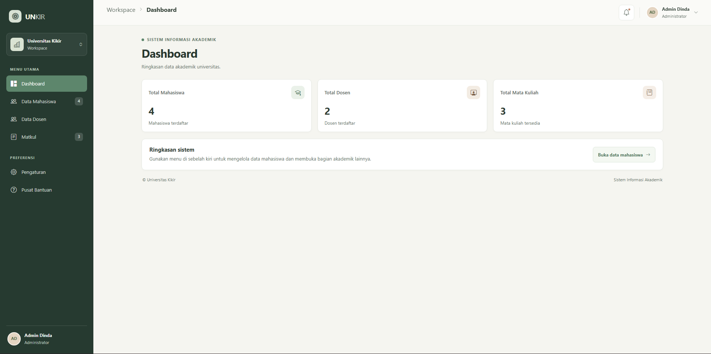
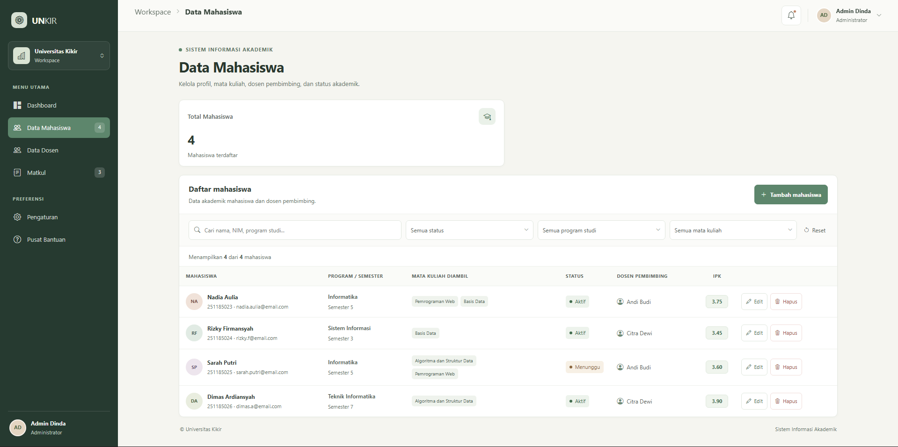
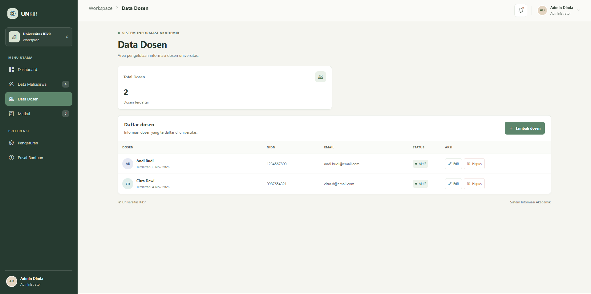
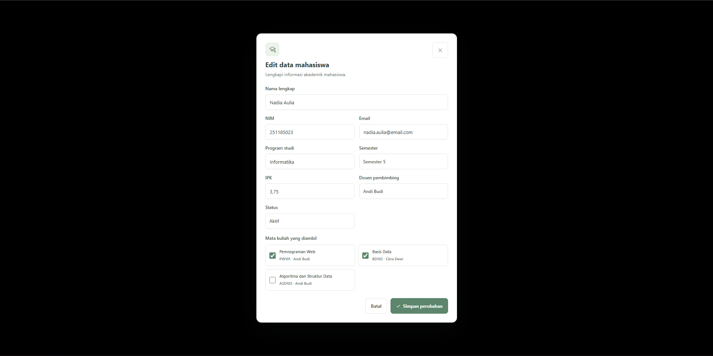

# RESPONSI Dashboard Data Mahasiswa &Akademik

Pada proyek responsi ini saya ditugaskan untuk membuat Dashboard Data Mahasiswa & Akademik dengan syarat: Tabel daftar mahasiswa (NIM, Nama, Program Studi, IPK, Status Aktif), filter pencarian data, serta modal form input nilai atau edit data mahasiswa.

## Cara menjalankannya

Masuklah kedalam foldernya dengan cara:

    cd RESPONSI-PFS1

setelah itu lakukan:

    npm run dev

## Fitur

### Dashboard

Menampilkan ringkasan informasi akademik universitas melalui beberapa komponen statistik, meliputi:

- Total mahasiswa yang terdaftar.
- Total dosen yang terdaftar.
- Total mata kuliah yang tersedia.
- Navigasi cepat menuju halaman pengelolaan data mahasiswa.

### Data Mahasiswa

Menyediakan fitur pengelolaan informasi mahasiswa, meliputi:

- Tambah Data: Menambahkan mahasiswa baru melalui formulir.
- Edit Data: Memperbarui informasi mahasiswa yang sudah terdaftar.
- Hapus Data: Menghapus data mahasiswa dengan konfirmasi sebelum penghapusan.
- Pencarian: Mencari mahasiswa berdasarkan nama, NIM, email, dosen pembimbing, atau program studi.

### Data Dosen

Menampilkan informasi dosen yang terdaftar di universitas, meliputi:

- Nama lengkap dosen.
- Nomor Induk Dosen Nasional (NIDN).
- Alamat email.
- Status keaktifan dosen.

### Data Mata Kuliah

Menampilkan informasi mata kuliah beserta dosen pengampu, meliputi:

- Kode mata kuliah.
- Nama mata kuliah.
- Nama dosen pengampu.

## Screenshot

### PROMPT YANG DIGUNAKAN

1. buatkan aku sebuah navbar dan tampilan untuk dashboard user: admin dengan color palette 5D866C, C2A68C, E6D8C3, F5F5F0
2. rombakin, fokus ke data mahasiswa, tunjukin tabelnya sama ada fitur edit, tapi variabel si dosen ama matkul dipertahanin, soalnya bakalan kepake untuk kedepannya, fokus ke data mahasiswa yang mengambil apa, dosen pembimbing saha, dll, buatin tabel yang terkait filter, search, status, dll. selain itu untuk masalah tampilan responsif ini belum terpenuhi, terus jujur masi kurang rapi si, sama keliatan ai slop, coba kamu atur-atur dalam segi tampilannya dengan aturan ini tapi ga berubah drastis gitu, cukup bikin user adminnya nyaman sama tampilannya:
   https://github.com/miqdadbadjuber/anti-slop.git

#### AI yang digunakan

- Github Copilot
- Chat-gpt
- Gemini
